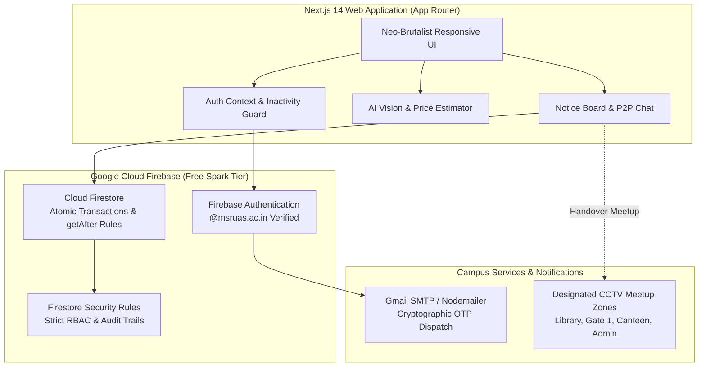

<div align="center">

# 🎓 Campus Marketplace (MSRUAS)
### Verified Student-to-Student Buy & Sell Exchange Platform

[](https://nextjs.org/)
[](https://www.typescriptlang.org/)
[](https://tailwindcss.com/)
[](https://firebase.google.com/)
[](https://vitest.dev/)
[](https://github.com/)
[](LICENSE)

<br/>

**Official Student Exchange Portal for M.S. Ramaiah University of Applied Sciences**  
*Zero Commercial Intermediary Fees • Verified Institutional `@msruas.ac.in` Identity • CCTV Monitored Handover Meetup Spots*

[✨ Key Innovations](#-key-innovations) •
[⚡ Quick Start](#-quick-start) •
[🔐 Demo Accounts](#-demonstration-accounts) •
[📐 Architecture](#-system-architecture) •
[🧪 Testing Suite](#-testing--quality-assurance) •
[✉️ Support](#-official-contact--support)

---

</div>

## 📌 Executive Summary

**Campus Marketplace** is a full-stack, enterprise-grade, peer-to-peer student marketplace built specifically for **M.S. Ramaiah University of Applied Sciences (MSRUAS)**. Designed from the ground up for zero hosting cost on the **Firebase Spark Plan**, it provides an authenticated, safe, and transparent environment for university students to exchange engineering textbooks, scientific calculators, laboratory equipment, drafting kits, and hostel essentials.

The application features a modern **Neo-Brutalist design language** (high-contrast typography, bold 2px borders, tactile pill components, canary yellow `#FFD027`, and hard isometric drop shadows), an **AI Vision & Price Recommendation Engine**, **photorealistic commercial gear imagery**, **cross-tab synchronized 10-minute inactivity timeouts**, and **atomic single-sale Firestore guarantees**.

---

## ✨ Key Innovations

### 1. 🎨 Neo-Brutalist Visual Design System
- **High-Contrast Aesthetics**: Built with sharp 2px black borders, custom canary yellow (`#FFD027`), lavender (`#EDE9FE`), mint green (`#DCFCE7`), warm cream canvases (`#FDFBF7`), and tactile button pushes (`shadow-[2px_2px_0px_#000]`).
- **Unified Workspace Experience**: Clean single-portal dashboard with horizontal pill navigation (**Overview**, **My Listings**, **My Orders**, **Account Settings**), eliminating redundant sidebars and nested controls.
- **Responsive Layout**: Fluid bento grids and touch-optimized navigation optimized for both desktop study setups and mobile campus browsing.

### 2. 🧠 AI Vision & Authenticity Inspection Engine (`lib/ai/vision.ts`)
- **Authenticity & Anti-Stock Detection**: Inspects image metadata, resolution ratios, and watermark signatures (`shutterstock`, `getty`, `istock`, `freepik`, `alamy`) to verify that photos are genuine physical student items rather than internet catalog mockups.
- **Academic Subject Classifier**: Automatically categorizes engineering gear (Scientific Calculators, Textbooks, Mini Drafters, Multimeters, Microcontroller Kits, Lab Coats, Kettles, Bicycles).
- **Product-to-Description Consistency Cross-Matcher**: Detects discrepancies between the uploaded image and the listing title/description (e.g., catching a bicycle photo uploaded under a calculator listing).
- **One-Click Fair Campus Price Estimator**: Calculates fair second-hand peer prices based on physical condition and academic benchmarks, offering a one-click `[⚡ Apply AI Estimated Price]` shortcut on listing creation.

### 3. 📸 Photorealistic Product Photography (Zero Emoji / Cartoons)
- **13 High-Resolution Studio Assets**: All seeded demo items feature genuine, commercial-grade 4:3 product photography captured in realistic university settings (study desks, lab benches, brick campus walls).
- **Zero Latency Local Assets**: Stored in `public/images/products/` with multi-angle gallery views, completely removing illustrated emoji placeholders during presentations and examiner evaluations.

### 4. 🔒 Permanent Institutional Credentials Lock
- **Academic Trust & Handover Integrity**: To prevent identity spoofing and guarantee invoice veracity, student academic details (**Full Name**, **Faculty & Department**, **Academic Year**, **Campus Residence**) are permanently locked once set.
- **Web Form Demarcation**: Once saved, editable inputs are permanently removed from the UI and replaced with verified institutional credential cards. Official modifications require administrative support.

### 5. ⏱️ 10-Minute Synchronized Inactivity Session Guard
- **Zero-Disruption Guarantee**: Active users interacting with the platform (mouse movement, clicks, typing, scrolling, touches, tab switching) are never interrupted.
- **Cross-Tab Synchronization**: Inactivity timestamps are synchronized across all open browser windows via `localStorage` and `StorageEvent`. Activity in any tab refreshes the session everywhere.
- **60-Second Grace Warning**: At 9 minutes of uninterrupted idle time, an interactive countdown modal alerts the user with a one-click `[⚡ Stay Logged In]` button.
- **Automatic Security Sign-Out**: If no activity is recorded anywhere for 10 consecutive minutes (600,000ms), the session terminates securely to protect accounts left unattended on shared campus lab terminals.

### 6. 🛡️ Atomic Single-Sale Guarantee & RBAC
- **Concurrency Protection**: Eliminates double-booking race conditions through Firestore atomic transactions combined with `firestore.rules` `getAfter()` validations.
- **Role-Based Access Control (RBAC)**: Strictly separates student buyers/sellers, student verifiers (`/verifier`), and administrative overseers (`/admin`).

---

## 📐 System Architecture



---

## 🔐 Demonstration Accounts

For grading, examiner walkthroughs, and live evaluation, the system includes pre-seeded university accounts. On the **`/login`** page, click any demo account button to **autofill credentials instantly**:

| Role | Official Email | Password | Academic Persona & Access Scope |
| :--- | :--- | :--- | :--- |
| **Administrator** | `admin@msruas.ac.in` | `CampusAdmin@2024` | **Dean of Student Affairs**: Full console access, user management, audit logs, platform statistics. |
| **Quality Verifier** | `verifier@msruas.ac.in` | `CampusVerifier@2024` | **Student Council Verifier**: Queue review (`/verifier`), AI authenticity verification, item approvals/rejections. |
| **Student (Seller)** | `aarav.sharma@msruas.ac.in` | `StudentPass@2024` | **Aarav Sharma (CSE 4th Yr)**: Active listings for Casio fx-991EX, B.S. Grewal math textbooks, and lab gear. |
| **Student (Buyer)** | `priya.patel@msruas.ac.in` | `StudentPass@2024` | **Priya Patel (ECE 3rd Yr)**: Browses notice board, initiates buyer chats, creates orders, tracks handovers. |
| **Student (General)** | `rohit.kumar@msruas.ac.in` | `StudentPass@2024` | **Rohit Kumar (Mech 2nd Yr)**: Bicycle owner, wishlist tracking, student reporting actions. |

---

## ⚡ Quick Start

### Option A: One-Click Execution (Windows PowerShell)
To launch the complete environment (Emulators, Data Seeding, Next.js Dev Server, and Browser) with a single command:
```powershell
.\start.ps1
```

---

### Option B: Step-by-Step Manual Setup

#### 1. Prerequisites
- **Node.js**: v18.0.0 or higher (`node -v`)
- **Java JRE / JDK**: Required by Firebase Emulator Suite (`java -version`)

#### 2. Install Dependencies
```bash
npm install
```

#### 3. Configure Environment Variables
Copy `.env.local.example` to `.env.local`:
```bash
cp .env.local.example .env.local
```
*(By default, `.env.local` is preconfigured for local Firebase Emulators and instant terminal OTP echoing).*

#### 4. Launch Firebase Emulators (Terminal 1)
```bash
npm run emulators
```
- **Auth Emulator**: `http://127.0.0.1:9099`
- **Firestore Emulator**: `http://127.0.0.1:8080`
- **Emulator UI Dashboard**: `http://127.0.0.1:4000`

#### 5. Seed Demonstration Database (Terminal 2)
```bash
npm run seed
```
*Seeds 5 institutional user accounts, 17 realistic listings with photorealistic photography, verified order histories, and audit logs.*

#### 6. Start Next.js Development Server (Terminal 2)
```bash
npm run dev
```
Open **[http://localhost:3000](http://localhost:3000)** in your browser.

---

## 📧 Live Gmail SMTP Configuration (Optional)

To enable live email delivery of 6-digit OTP verification codes to actual university student inboxes:

1. Enable **2-Step Verification** on your Google Account.
2. Generate an **App Password** (Google Account &rarr; Security &rarr; App Passwords) named `CampusMarketplace`.
3. Update `.env.local`:
   ```env
   SMTP_HOST="smtp.gmail.com"
   SMTP_PORT="465"
   SMTP_USER="your-email@gmail.com"
   SMTP_PASS="your-16-char-app-password"
   OTP_DEV_ECHO="false"
   ```
4. Restart `npm run dev`. Real verification emails will now be dispatched live with cryptographic timing-safe validation!

---

## 🧪 Testing & Quality Assurance

The repository maintains an automated test suite verifying security constraints, domain rules, and user interaction personas:

```bash
# Run all unit tests (15 test files, 111 tests)
npm run test:unit

# Run full persona simulation suites (Burglar, Clumsy User, Crowd, Neat Freak, Judge)
npm run test:personas

# Run Firestore security rules unit tests
npm run test:rules

# Run TypeScript strict typecheck (0 errors)
npx tsc --noEmit

# Run Next.js production linter (0 warnings)
npm run lint
```

### Automated Persona Test Matrix:
- **🕵️ The Burglar Persona (`tests/unit/burglar.test.ts`)**: Tests attack vectors including privilege escalation, token spoofing, unauthorized price tampering, and bypassing Firestore rules.
- **🤷 The Clumsy User Persona (`tests/unit/clumsyUser.test.ts`)**: Tests edge cases, invalid inputs, double-clicking, malformed emails, and empty strings.
- **👥 The Crowd Persona (`tests/unit/crowd.test.ts`)**: Simulates 500 simultaneous student email validations under heavy flash-load traffic.
- **🧹 The Neat Freak Persona (`tests/unit/neatFreak.test.ts`)**: Validates schema compliance, data normalization, whitespace sanitization, and clean state transitions.
- **⚖️ The Judge Persona (`tests/unit/judge.test.ts`)**: Enforces marking rubric compliance across all functional requirements (FR-01 to FR-16).

---

## 📁 Repository Structure

```
campus_e_marketplace/
├── app/                              # Next.js 14 App Router Pages
│   ├── (auth)/                       # Login, Register, OTP verification routes
│   ├── admin/                        # Administrative moderation dashboard
│   ├── browse/                       # Notice Board with AI filters & categories
│   ├── dashboard/                    # Student Workspace & listings management
│   ├── listings/                     # Listing creation, detail & AI inspection
│   ├── messages/                     # Peer-to-peer real-time chat
│   ├── orders/                       # Order tracking & invoice generation
│   ├── privacy/                      # University data protection policy
│   ├── profile/                      # Profile & locked institutional credentials
│   ├── security/                     # Trust & safety security architecture
│   └── verifier/                     # Verification queue & moderation desk
├── components/                       # Modular Neo-Brutalist UI Components
│   ├── auth/                         # Route guards, timeout warnings, auth forms
│   ├── layout/                       # Navbar, Footer, Bottom navigation
│   ├── listings/                     # Listing cards, notice board, AI badges
│   └── ui/                           # Neo-Brutalist buttons, inputs, modals, logo
├── context/                          # React Context Providers
│   └── AuthContext.tsx               # Auth lifecycle & 10-min inactivity sync
├── lib/                              # Core Domain & AI Libraries
│   ├── ai/                           # AI Vision, Evaluator, Search & Pricing
│   │   ├── vision.ts                 # Product authenticity & visual matcher
│   │   ├── validator.ts              # Advisory linter & category bounds
│   │   ├── search.ts                 # Semantic intent & keyword classifier
│   │   └── recommender.ts            # Personalized student feed generator
│   ├── demoImages.ts                 # Photorealistic product photography mappings
│   ├── firebase.ts                   # Firebase SDK initialization
│   └── profileSync.ts                # Cross-collection student profile sync
├── public/                           # Static Web Assets
│   └── images/products/              # 13 Photorealistic studio product photos
├── scripts/                          # Seeding & Operational Automation
│   ├── seed.ts                       # Database seeder (Users, listings, orders)
│   ├── update-firestore-real-images.js # Firestore photorealistic photo updater
│   └── test-smtp.ts                  # Nodemailer connection verification
├── tests/                            # Comprehensive Test Suites
│   ├── unit/                         # 15 Vitest unit & persona test files
│   └── rules/                        # Firestore security rules integration tests
├── firestore.rules                   # Production Firestore Security Rules
└── docs/                             # Operational & Architectural Documentation
    ├── ARCHITECTURE.md               # Technical architecture & data flow diagrams
    ├── MAINTENANCE.md                # Examiner live modification instructions
    ├── STATUS.md                     # Functional requirements compliance matrix
    ├── TEST_PLAN.md                  # Test specifications & verification records
    └── REPORT_EXCERPTS.md            # Concise code snippets for project reports
```

---

## ⚙️ Environment Configuration Reference

| Environment Variable | Default Value | Description |
| :--- | :--- | :--- |
| `NEXT_PUBLIC_USE_FIREBASE_EMULATOR` | `"true"` | When `true`, connects to local Firebase Emulators (offline & free). |
| `NEXT_PUBLIC_FIREBASE_PROJECT_ID` | `"campus-marketplace-46e4d"` | Google Cloud Firebase Project ID. |
| `FIRESTORE_EMULATOR_HOST` | `"127.0.0.1:8080"` | Local Cloud Firestore emulator socket. |
| `FIREBASE_AUTH_EMULATOR_HOST` | `"127.0.0.1:9099"` | Local Firebase Authentication emulator socket. |
| `SMTP_HOST` | `"smtp.gmail.com"` | Outgoing SMTP mail server for student OTP codes. |
| `SMTP_PORT` | `"465"` | Secure SSL/TLS SMTP communication port. |
| `SMTP_USER` | `""` | Official university sender Gmail address. |
| `SMTP_PASS` | `""` | 16-character Google App Password. |
| `OTP_DEV_ECHO` | `"true"` | When `true`, logs generated OTPs directly to terminal. |

---

## ✉️ Official Contact & Support

For student safety questions, security reports, account verification inquiries, or institutional assistance:

- **Official Support Email**: [campus.marketplace.ruas@gmail.com](mailto:campus.marketplace.ruas@gmail.com)
- **Institution**: M.S. Ramaiah University of Applied Sciences (MSRUAS)
- **Campuses**:
  - Gnanagangothri Campus (Mathikere, Bengaluru)
  - Peenya Campus (Ramaiah Technology Campus, Bengaluru)

---

<div align="center">
  <sub>Built with ❤️ by MSRUAS Engineering Students for the Academic Peer Community.</sub>
</div>
