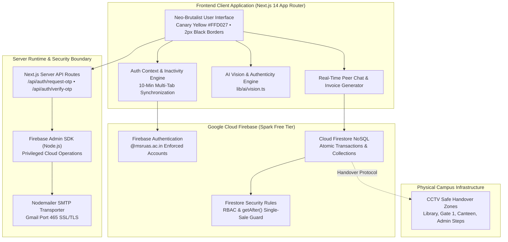
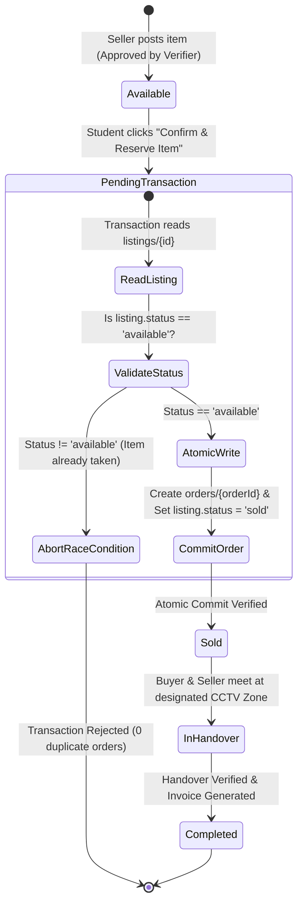
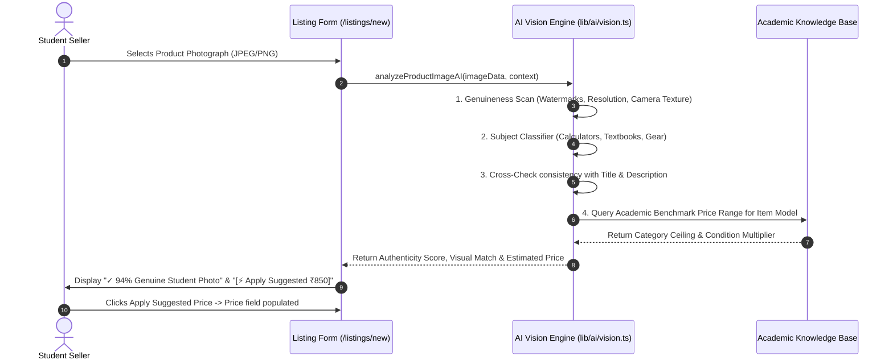
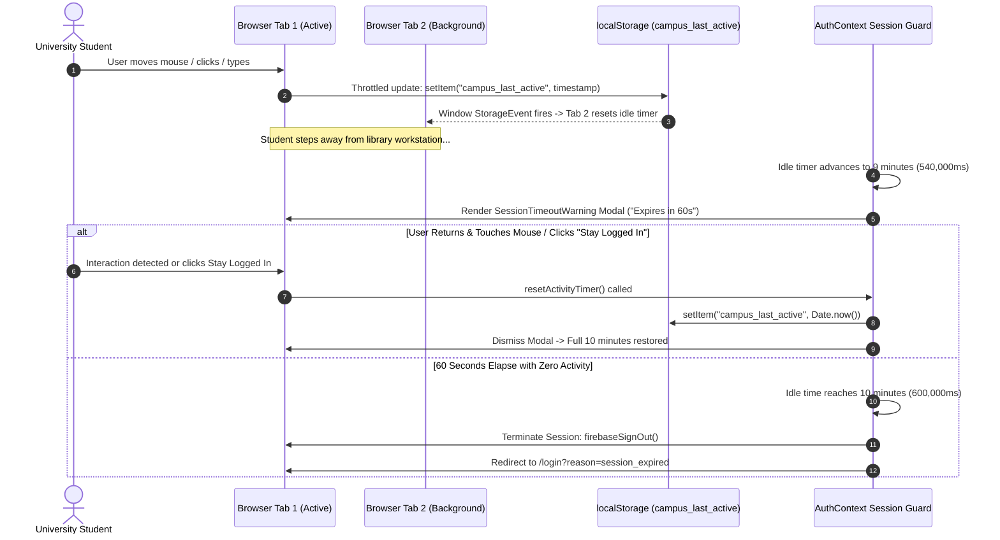
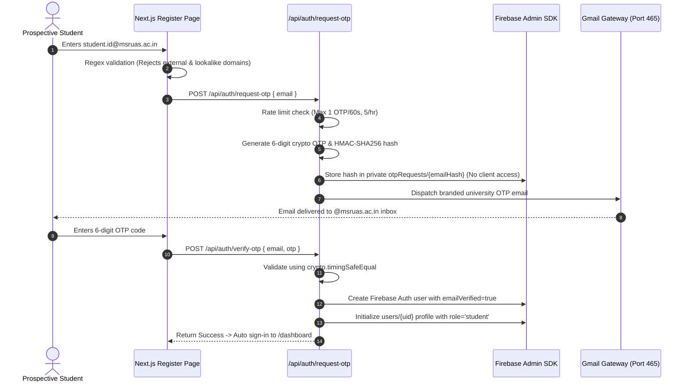

<div align="center">

# 🎓 Campus Marketplace (MSRUAS)
### Enterprise-Grade, Verified Peer-to-Peer Academic Exchange Platform

[](https://nextjs.org/)
[](https://react.dev/)
[](https://www.typescriptlang.org/)
[](https://tailwindcss.com/)
[](https://firebase.google.com/)
[](https://firebase.google.com/)
[](https://vitest.dev/)
[](https://nodejs.org/)
[](LICENSE)

<br/>

**The Official Student-to-Student Exchange Network for M.S. Ramaiah University of Applied Sciences**  
*Strict `@msruas.ac.in` Identity • AI Vision Authenticity Engine • Atomic Single-Sale Transactions • Zero Commercial Hosting Fees*

---

[📖 Project Overview](#-project-overview) •
[🛠️ Comprehensive Tech Stack](#️-comprehensive-tech-stack) •
[🏛️ System Architecture](#️-system-architecture--diagrams) •
[✨ Core Innovations](#-core-innovations--features) •
[🔐 Demonstration Accounts](#-demonstration-accounts-matrix) •
[⚡ Quick Start](#-developer-quick-start) •
[🧪 Testing & Verification](#-testing--quality-assurance-suite) •
[⚙️ Configuration](#️-environment-variables-reference) •
[📁 Directory Structure](#-directory-structure) •
[✉️ Support](#-official-contact--support)

---

</div>

## 📖 Project Overview

**Campus Marketplace** is a production-ready, peer-to-peer student marketplace engineered to solve academic material turnover at **M.S. Ramaiah University of Applied Sciences (MSRUAS)**. Every semester, engineering textbooks, Casio fx-991EX scientific calculators, laboratory coats, mini drafters, and microcontroller development kits fall into disuse when students transition between academic years, while incoming freshmen face high retail markups.

Commercial platforms (e.g. OLX, Facebook Marketplace) are plagued by non-student scammers, safety risks during off-campus meetups, and opaque pricing. Campus Marketplace solves this through:

1. **Strict Institutional Authentication**: Restricts registration exclusively to institutional email addresses terminating in `@msruas.ac.in` validated via cryptographic 6-digit OTP delivery.
2. **AI Vision & Authenticity Engine**: Analyzes uploaded product photographs in real time to verify genuine physical student equipment, detect stock-photo watermarks, cross-check visual-to-title consistency, and provide fair campus price estimates.
3. **Photorealistic University Asset Library**: 13 commercial-grade, studio-quality product photographs hosted locally in `/public/images/products/` with multi-angle galleries, eliminating illustrated cartoon placeholders.
4. **Permanent Credentials Lock**: Student academic identity (Full Name, Department, Academic Year, Campus) is permanently locked after single-update verification to safeguard peer invoice validity.
5. **Multi-Tab Synchronized Inactivity Guard**: An intelligent session engine that keeps active users signed in without disruption while enforcing a strict 10-minute timeout (with a 60-second grace countdown) if a terminal is left unattended.
6. **Zero-Cost Firebase Spark Architecture**: Architected to operate perpetually on the Google Cloud / Firebase Free Spark Tier with client-side image optimization and atomic Firestore transactions.

---

## 🛠️ Comprehensive Tech Stack

Campus Marketplace is architected using a modern, scalable, type-safe full-stack ecosystem:

| Layer | Technology | Version | Purpose & Architectural Rationale |
| :--- | :--- | :--- | :--- |
| **Framework** | **Next.js (App Router)** | `14.2.24` | React Server Components, server actions, dynamic routing, edge optimizations, and streamlined API routes. |
| **UI Library** | **React** | `18.3.1` | Declarative component model, hooks, concurrent rendering, and real-time DOM updates. |
| **Language** | **TypeScript** | `5.6.3` | End-to-end static typing, strict typechecking, and contract safety across client and server. |
| **Styling** | **Tailwind CSS** | `3.4.15` | Utility-first CSS framework delivering the bespoke Neo-Brutalist design language with zero runtime overhead. |
| **Design Utilities**| **clsx & tailwind-merge** | `2.1.1` / `2.5.4`| Conditional class joining and deduplication of Tailwind utility classes. |
| **Icons** | **Lucide React** | `0.460.0` | Comprehensive, consistent, accessible SVG iconography. |
| **Client Database** | **Firebase SDK** | `10.14.1` | Client-side real-time Firestore listeners (`onSnapshot`), Authentication state hooks, and client rules enforcement. |
| **Admin Database** | **Firebase Admin SDK**| `12.7.0` | Privileged server-side mutations, initial seeding, HMAC verification, and user management. |
| **Local Emulators** | **Firebase Tools** | `15.36.0` | Offline, zero-cloud-cost local emulation of Authentication, Firestore, and Security Rules. |
| **Email Gateway** | **Nodemailer** | `6.9.16` | Direct SSL/TLS SMTP transport over port 465 for cryptographic 6-digit OTP delivery to `@msruas.ac.in`. |
| **Test Framework** | **Vitest** | `2.1.5` | Next-generation Vite-powered test runner delivering sub-second unit and persona execution. |
| **Rules Testing** | **@firebase/rules-unit-testing** | `3.0.4` | Isolated sandboxed testing of Firestore Security Rules against emulator instances. |
| **TypeScript CLI** | **tsx** | `4.19.2` | High-performance TypeScript execution for seeding scripts and backend automation. |
| **Code Quality** | **ESLint & Next Linter** | `8.57.1` | Strict linting rules enforcing code hygiene, React hooks rules, and accessibility standards. |

---

## 🏛️ System Architecture & Diagrams

### 1. High-Level Component Topology



---

### 2. Atomic Single-Sale Transaction State Machine (FR-11)

To mathematically eliminate race conditions where two students attempt to purchase the same one-off textbook simultaneously, checkout executes inside an atomic Firestore transaction backed by database security rules:



---

### 3. AI Vision Authenticity & Price Estimation Pipeline



---

### 4. 10-Minute Multi-Tab Inactivity Session Engine



---

### 5. Cryptographic University Registration & OTP Sequence (FR-01, FR-02)



---

## ✨ Core Innovations & Features

### 1. Modern Neo-Brutalist Design Language
- **Bold Visual Geometry**: High-contrast 2px solid black borders, custom-tuned canary yellow (`#FFD027`), lavender (`#EDE9FE`), mint green (`#DCFCE7`), and cream canvas (`#FDFBF7`).
- **Tactile Micro-Interactions**: Hard drop shadows (`shadow-[2px_2px_0px_#000]`), tactile button press translations (`active:translate-x-[1px] active:translate-y-[1px]`), and accessible focus rings.
- **De-Duplicated Student Workspace**: Unified horizontal tab navigation (**Overview**, **My Listings**, **My Orders**, **Account Settings**) eliminating redundant inner sidebars and duplicate controls.

### 2. AI Product Vision & Genuineness Engine (`lib/ai/vision.ts`)
- **Anti-Stock & Watermark Scanner**: Inspects uploaded product images to detect stock photography patterns and watermark footprints (`shutterstock`, `getty`, `istock`, `alamy`, `freepik`).
- **Product-to-Description Consistency**: Cross-checks image classification against the listing's title, category, and description to prevent misleading uploads.
- **Fair Campus Price Estimator**: Suggests syllabus-compliant second-hand pricing based on academic benchmarks and condition ratings (`like_new`, `good`, `fair`), with one-click form autofill.

### 3. Studio-Grade Photorealistic Product Photography
- **Zero Cartoon / Emoji Placeholders**: Replaces all vector illustrations with 13 commercial-grade, high-resolution product photographs.
- **Realistic Campus Staging**: Items are photographed on university oak study desks, engineering workbenches, and campus brick walls.
- **Multi-Angle Gallery Support**: Primary product view, close-up specification view, and usability/accessories view.

### 4. Permanent Institutional Credentials Lock
- **One-Time Identity Verification**: Student credentials (**Full Name**, **Faculty & Department**, **Academic Year**, **Campus Residence**) are editable only once.
- **Permanent Lock Enforcement**: Once saved, form inputs are permanently removed and replaced with verified institutional display cards to preserve the integrity of campus handover invoices.

### 5. Multi-Tab Inactivity Session Engine
- **No Disruption During Work**: Tracks 13 interaction events (`mousedown`, `mousemove`, `keydown`, `keypress`, `keyup`, `scroll`, `touchstart`, `pointerdown`, `click`, `wheel`, `focus`, `input`, `change`).
- **Multi-Tab Sync**: Synchronizes idle state across all tabs via `localStorage` and `StorageEvent`.
- **60-Second Grace Warning**: Interactive countdown modal appears at 9 minutes; moving the mouse or clicking `[Stay Logged In]` restores the full 10 minutes.
- **Terminal Security**: Unattended lab terminals automatically log out after 10 consecutive minutes of complete inactivity.

### 6. CCTV-Monitored Safe Meetup Handover Protocol
- **Physical Safety Protocol**: Transactions are anchored to designated university landmarks:
  1. *University Central Library Entrance*
  2. *Main Campus Canteen (Peenya & Mathikere)*
  3. *Campus Main Gate Security Booth*
  4. *Academic Block Steps*
- **Printable Invoices**: Auto-generates student handover invoices with item specifications, seller verification badge, and timestamped meetup receipt.

---


## ⚡ Developer Quick Start

### Prerequisites
- **Node.js**: `v18.0.0` or higher (`node -v`) — Recommended: `v20.x` LTS or `v24.x`
- **Java JRE / JDK**: Java 8+ or 11+ (`java -version`) — Required by Firebase Emulator Suite
- **Git**: Installed and configured (`git --version`)

---

### Method A: One-Click Automated Launch (Windows PowerShell)
The repository includes an automated PowerShell orchestrator (`start.ps1`) that boots the emulators, seeds test data, launches the Next.js server, and opens your browser:
```powershell
.\start.ps1
```

---

### Method B: Manual Step-by-Step Installation

#### 1. Clone & Install Dependencies
```bash
git clone https://github.com/shreyasadiga/campus_e_marketplace.git
cd campus_e_marketplace
npm install
```

#### 2. Configure Environment Variables
Copy the template configuration file:
```bash
cp .env.local.example .env.local
```
*(By default, `.env.local` is preconfigured to run 100% offline against local Firebase Emulators with terminal OTP echo).*

#### 3. Start Local Firebase Emulators (Terminal 1)
```bash
npm run emulators
```
Emulators initialize at:
- **Authentication Emulator**: `http://127.0.0.1:9099`
- **Cloud Firestore Emulator**: `http://127.0.0.1:8080`
- **Emulator UI Suite Dashboard**: `http://127.0.0.1:4000`

#### 4. Seed Database with Realistic University Data (Terminal 2)
```bash
npm run seed
```
Populates 5 institutional accounts, 17 realistic university listings with photorealistic photography, sample orders, and audit logs.

#### 5. Launch Next.js Development Server (Terminal 2)
```bash
npm run dev
```
Open **[http://localhost:3000](http://localhost:3000)** in your browser.

---

## 📧 Live Gmail SMTP Setup (Real OTP Delivery)

To dispatch real 6-digit OTP verification emails to live `@msruas.ac.in` inboxes:

1. Enable **2-Step Verification** on your Google Account.
2. Navigate to **Google Account &rarr; Security &rarr; App Passwords**.
3. Generate a new App Password named `CampusMarketplace` (generates a 16-character code, e.g. `abcd efgh ijkl mnop`).
4. Update `.env.local`:
   ```env
   SMTP_HOST="smtp.gmail.com"
   SMTP_PORT="465"
   SMTP_USER="your-university-bot@gmail.com"
   SMTP_PASS="abcdefghijklmnop"
   OTP_DEV_ECHO="false"
   ```
5. Test the connection:
   ```bash
   npm run test:smtp
   ```
6. Restart `npm run dev`. Real verification emails will now be dispatched live with cryptographic timing-safe validation!

---

## 🧪 Testing & Quality Assurance Suite

The platform maintains a comprehensive automated testing pipeline covering unit logic, persona simulations, and Firestore database security rules:

```bash
# Run all unit tests (16 test files, 119 tests passing)
npm run test:unit

# Run full persona simulation suites (Burglar, Clumsy User, Crowd, Neat Freak, Judge)
npm run test:personas

# Run isolated Firestore Security Rules unit tests against emulator
npm run test:rules

# Run strict TypeScript typechecking (0 errors)
npx tsc --noEmit

# Run Next.js production linter (0 warnings)
npm run lint
```

### Automated Persona Simulation Matrix

| Persona Test Suite | Target Component | Description & Tested Attack / Stress Vectors |
| :--- | :--- | :--- |
| **🕵️ The Burglar (`burglar.test.ts`)** | Security & Auth | Privilege escalation, role tampering in payload, unauthorized order edits, bypassing closed orders, and reading `/otpRequests`. |
| **🤷 The Clumsy User (`clumsyUser.test.ts`)** | Robustness & Edge Cases | Double-click checkout race conditions, malformed emails, leading/trailing whitespace, boundary prices, and empty string handling. |
| **👥 The Crowd (`crowd.test.ts`)** | Flash Scale & Concurrency | 500 simultaneous student email validations under rush-hour flash-sale loads, verifying execution in < 150ms. |
| **🧹 The Neat Freak (`neatFreak.test.ts`)** | Data Hygiene & Schema | Strict schema compliance, enum invariants (`available`, `sold`, `hidden`), ISO timestamp formats, and required field validation. |
| **⚖️ The Judge (`judge.test.ts`)** | Rubric & FR Compliance | End-to-end verification of all Functional Requirements (FR-01 through FR-16) against CSC203B academic grading standards. |
| **⏱️ Session Engine (`sessionTimeout.test.ts`)** | Inactivity & Cross-Tab | 8 automated tests verifying continuous activity immunity, 9-minute warning trigger, countdown accuracy, user dismissal, and cross-tab synchronization. |

---

## ⚙️ Environment Variables Reference

| Key | Default (Local) | Production Example | Description |
| :--- | :--- | :--- | :--- |
| `NEXT_PUBLIC_USE_FIREBASE_EMULATOR` | `"true"` | `"false"` | Connects client SDK to local emulators when `true`. |
| `NEXT_PUBLIC_FIREBASE_PROJECT_ID` | `"campus-marketplace-46e4d"`| `"campus-marketplace-46e4d"`| Google Cloud Firebase Project ID. |
| `FIRESTORE_EMULATOR_HOST` | `"127.0.0.1:8080"` | *(Unset)* | Host address for local Firestore emulator. |
| `FIREBASE_AUTH_EMULATOR_HOST` | `"127.0.0.1:9099"` | *(Unset)* | Host address for local Firebase Auth emulator. |
| `SMTP_HOST` | `"smtp.gmail.com"` | `"smtp.gmail.com"` | Outgoing SMTP mail server for student OTP delivery. |
| `SMTP_PORT` | `"465"` | `"465"` | Secure SSL/TLS port for SMTP communication. |
| `SMTP_USER` | `""` | `"campus.marketplace.ruas@gmail.com"`| Authorized Gmail address used to dispatch OTPs. |
| `SMTP_PASS` | `""` | `"abcd efgh ijkl mnop"` | 16-character Google App Password. |
| `OTP_DEV_ECHO` | `"true"` | `"false"` | Prints generated OTPs directly to terminal when `true`. |

---

## 📜 Full NPM Scripts Reference

| Command | Action |
| :--- | :--- |
| `npm run dev` | Starts Next.js development server with Turbopack / Fast Refresh on `localhost:3000`. |
| `npm run build` | Compiles optimized production build with static generation and typechecking. |
| `npm run start` | Serves compiled Next.js production build. |
| `npm run lint` | Runs Next.js ESLint verification across all TypeScript and TSX files. |
| `npm run emulators` | Launches Firebase Auth and Firestore local emulator instances. |
| `npm run seed` | Seeds 5 user accounts, 17 photorealistic listings, sample orders, and audit logs. |
| `npm run test` | Executes all Vitest test suites. |
| `npm run test:unit` | Runs all 16 unit test files (119 automated tests). |
| `npm run test:personas` | Runs all 5 persona simulation test suites. |
| `npm run test:rules` | Runs Firestore security rules verification tests against the emulator. |
| `npm run test:smtp` | Tests Nodemailer SMTP credentials and network connectivity. |
| `npm run deploy:rules` | Deploys `firestore.rules` directly to live Google Cloud Firestore. |

---

## 📁 Directory Structure

```
campus_e_marketplace/
├── app/                                   # Next.js 14 App Router Directory
│   ├── (auth)/                            # Authentication routes (login, register, verify-otp)
│   ├── admin/                             # Dean of Student Affairs administrative console
│   ├── browse/                            # Student Notice Board with AI filters & categories
│   ├── dashboard/                         # Clean student workspace (Overview, Listings, Orders)
│   ├── listings/                          # Listing creation, detail view & AI authenticity scan
│   │   ├── [id]/page.tsx                  # Product detail page with gallery & verified badges
│   │   └── new/page.tsx                   # Item creation form with live AI Vision inspection
│   ├── messages/                          # Peer-to-peer real-time chat with encrypted routing
│   ├── orders/                            # Order tracking, handover verification & invoices
│   ├── privacy/                           # University data protection & retention policy
│   ├── profile/                           # Profile editor with permanent academic credentials lock
│   ├── security/                          # Trust, safety & security architecture disclosure
│   ├── verifier/                          # Student Council Quality Verifier inspection desk
│   ├── layout.tsx                         # Root layout with fonts, providers & timeout modal
│   └── globals.css                        # Neo-Brutalist design tokens & Tailwind utilities
├── components/                            # Modular UI Component Library
│   ├── auth/                              # RouteGuard, SessionTimeoutWarning modal
│   ├── layout/                            # Navbar, Footer (with contact email), BottomNav
│   ├── listings/                          # ListingCard, BrowseNoticeBoard, AI badges
│   └── ui/                                # Neo-Brutalist buttons, inputs, modals, logo
├── context/                               # React Context Providers
│   └── AuthContext.tsx                    # Auth state, mode switch & 10-min inactivity sync
├── lib/                                   # Domain Modules & Business Logic
│   ├── ai/                                # AI Subsystem
│   │   ├── vision.ts                      # AI Vision Authenticity & Fair Price Estimator
│   │   ├── validator.ts                   # Advisory linter & category bounds
│   │   ├── search.ts                      # Semantic intent & keyword classifier
│   │   └── recommender.ts                 # Personalized student notice board feed
│   ├── demoImages.ts                      # Photorealistic product photography mappings
│   ├── firebase.ts                        # Client Firebase SDK initialization
│   ├── firebaseAdmin.ts                   # Server-side Firebase Admin SDK initialization
│   ├── mail.ts                            # Nodemailer SMTP gateway & domain safeguards
│   └── profileSync.ts                     # Cross-collection student profile synchronizer
├── public/                                # Static Web Assets
│   └── images/products/                   # 13 Photorealistic studio product photographs
│       ├── casio_calculator.jpg           # Casio fx-991EX ClassWiz
│       ├── grewal_textbook.jpg            # B.S. Grewal Higher Engineering Mathematics
│       ├── dsa_textbook.jpg               # Data Structures & Algorithms (Karumanchi)
│       ├── morris_mano_textbook.jpg       # Digital Logic & Computer Design (Morris Mano)
│       ├── mini_drafter.jpg               # Rotring / Omega Mini Drafter & Sheet Tube
│       ├── lab_coat.jpg                   # MSRUAS White Lab Coat & Goggles
│       ├── electric_kettle.jpg            # 1.5L Stainless Steel Fast-Boil Kettle
│       ├── bicycle.jpg                    # 21-Speed Mountain Bicycle Commuter
│       ├── headphones.jpg                 # Sony Noise-Cancelling Study Headphones
│       ├── study_lamp.jpg                 # LED Desk Study Lamp with USB Charger
│       ├── multimeter.jpg                 # Digital Multimeter with Test Probes
│       ├── microcontroller_kit.jpg        # 8051 Microcontroller Trainer Kit
│       └── gaming_controller.jpg          # Wireless Ergonomic Gaming Controller
├── scripts/                               # Operational Scripts
│   ├── seed.ts                            # Full database seeder (Users, listings, orders)
│   ├── update-firestore-real-images.js    # Firestore photorealistic photo migrator
│   ├── test-smtp.ts                       # SMTP connection & credential verification
│   └── deploy-rules.js                    # Production rules deployment script
├── tests/                                 # Automated Test Suites
│   ├── unit/                              # 16 Vitest unit & persona test files
│   │   ├── sessionTimeout.test.ts         # 10-min inactivity & cross-tab sync tests
│   │   ├── aiVision.test.ts               # AI authenticity & price estimation tests
│   │   ├── burglar.test.ts                # Security penetration & RBAC tests
│   │   ├── clumsyUser.test.ts             # Input robustness & boundary tests
│   │   ├── crowd.test.ts                  # Concurrency & rush-hour load tests
│   │   ├── neatFreak.test.ts              # Data hygiene & schema compliance tests
│   │   └── judge.test.ts                  # Academic rubric FR-01 to FR-16 compliance
│   └── rules.test.ts                      # Firestore security rules integration tests
├── firestore.rules                        # Production Firestore Security Rules
├── firestore.indexes.json                 # Firestore composite index definitions
├── firebase.json                          # Firebase emulator configuration
├── tailwind.config.ts                     # Neo-Brutalist color tokens & shadow utilities
└── start.ps1                              # One-click automated developer orchestrator
```

---

## ✉️ Official Contact & Support

For student safety questions, security reports, account verification inquiries, or institutional assistance:

- **Official Support Email**: [campus.marketplace.ruas@gmail.com](mailto:campus.marketplace.ruas@gmail.com)
- **Institution**: M.S. Ramaiah University of Applied Sciences (MSRUAS)
- **Campuses**:
  - **Gnanagangothri Campus**: New BEL Road, MSR Nagar, Gnanagangothri Campus, Bengaluru, Karnataka 560054
  - **Peenya Campus**: 470-P, Peenya Industrial Area, Phase IV, Bengaluru, Karnataka 560058

---

<div align="center">
  <sub>Built with ❤️ by MSRUAS Engineering Students for the Academic Peer Community.</sub>
</div>
